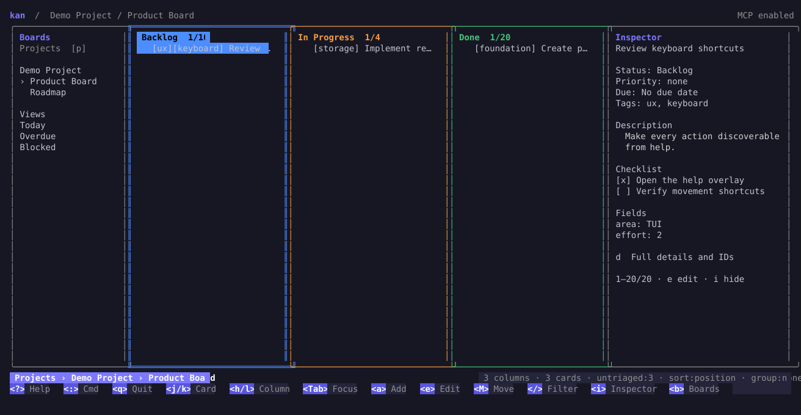

# kan

[](https://github.com/epoxsizer/kan/actions/workflows/ci.yml)
[](https://github.com/epoxsizer/kan/actions/workflows/release.yml)
[](LICENSE)

`kan` is a local-first task tracker with a terminal interface. It stores data in
SQLite and does not require a server, account, or network connection.

Data hierarchy:

```text
Project -> Board -> Column -> Card
```

The app includes full-text search, tags, priorities, due dates, Markdown card
descriptions, checklists, custom fields, linked cards, JSON import/export,
automatic local backups, and optional S3 JSON synchronization.

Current version: `0.1.19`.

## Interface



The interface adapts to terminal size. The active column and selected card are
highlighted, and contextual key hints are shown at the bottom of the screen.
Selecting a card changes only its background by default, without changing its
text, indentation, or height. Set `show_selected_card_details = true` to add an
aligned second line with priority, due information, checklist progress, tags,
and related-card count. Card titles wrap onto extra lines by default
(`wrap_card_titles = true`); set it to `false` to truncate them to one line.
Markdown descriptions remain in the scrollable detail
window. Board lists summarize overdue or nearest-due work.

The header keeps the project and board visible. At 110 columns the board can
show a scrollable card inspector; at 140×18 it also shows board navigation.
Use `i` and `b` to toggle those panes, and `Tab` / `Shift-Tab` to change focus.
On smaller terminals, `i` opens full-screen details and `b` returns to the board
list. Projects, boards, form fields, dropdowns, and related-card lists scroll to
keep the selected item visible after resizing. Terminals smaller than 32×12
show a resize message and keep the current draft in memory.

Kan honors `NO_COLOR`; selection then uses a `>` marker. Refreshes keep existing
content visible, and recoverable failures appear in the status line. `A` opens
the agent activity recorded during the current TUI session.

## Quick Start From Source

Go 1.25 or newer is required.

```sh
git clone https://github.com/epoxsizer/kan.git
cd kan
make build
./bin/kan seed
./bin/kan
```

The `seed` command creates deterministic demo projects, boards, columns, and
cards. It is idempotent, so it can be run repeatedly without duplicating data.

To start with an empty database:

```sh
make build
./bin/kan migrate
./bin/kan
```

## Install A Release

Download the archive for Linux, macOS, or Windows from
[GitHub Releases](https://github.com/epoxsizer/kan/releases), verify it with
`checksums.txt`, and place the `kan` binary in a directory from your `PATH`.

You can also install with Go:

```sh
go install github.com/epoxsizer/kan/cmd/kan@latest
```

Released binaries can check for and install the latest stable public release:

```sh
kan upgrade --check
kan upgrade check
kan upgrade
```

When the TUI starts, `kan` checks for a newer version in the background at most
once every 24 hours. If an update exists, the status line suggests running
`kan upgrade`; startup is never delayed and network failures are only written to
the log. Successful downloads are verified against the release
`checksums.txt` before the current executable is replaced. Development builds
cannot self-upgrade, and protected installation paths must be updated manually
or by the account that owns the executable.

For private GitHub repositories, export `KAN_GITHUB_TOKEN`, `GH_TOKEN`, or
`GITHUB_TOKEN` with repository Contents read access before checking or upgrading:

```sh
export KAN_GITHUB_TOKEN="github_pat_..."
kan upgrade check
```

## Key Bindings

| Key | Action |
|---|---|
| Left click | Select an item; click the selected item again to open it |
| Double click | Open a board card directly in the editor |
| Left drag | Drag a board card to another column or position; `Esc` cancels, `u` undoes the drop |
| Mouse wheel | Navigate lists/cards or scroll the active detail/control |
| Right click | Back, close, or cancel like `Esc` |
| `h j k l`, arrows | Navigate |
| `Enter`, `d` | Open the selected object in a compact detail window |
| `e` | Edit the selected object or card |
| `Shift-E` | Configure the selected column; toggle compact/full-screen when a detail window is open |
| `a` | Add a card or object on the current screen |
| `D` | Delete with confirmation |
| `H`, `L` | Move the selected card to the previous/next column |
| `Tab`, `Shift-Tab` | Change focus between the board, inspector, and navigation |
| `i`, `b` | Toggle the inspector / board navigation; open details / board list on smaller terminals |
| `A`, `:view activity` | Show agent changes recorded in this TUI session |
| `Shift-Left`, `Shift-Right` | Move the selected column left or right |
| `:column move-left`, `:column move-right` | Reorder the selected column from the command menu |
| `J`, `K` | Reorder cards |
| `M` | Choose a destination column |
| `u` | Undo the last successful move or reorder |
| `/` | Search within the current board |
| `:` | Open hierarchical action menus for cards, columns, boards, projects, settings, and views |
| `:card archive` | Archive the selected card with confirmation |
| `:card export` | Write the selected card as a Markdown file in the working directory |
| `:card queue` | Queue the selected card for agent processing (`kan agent run`) |
| `:column archive` | Archive every active card in the selected column |
| `:view archived` | Show archived cards for the current board |
| `:column settings` | Configure the selected column |
| `:view today`, `:view overdue`, `:view blocked`, `:view stale`, `:view untriaged` | Show planning views for the current board |
| `:card new-template`, `:card save-template`, `:card from-template`, `:card templates` | Create and use board-only card templates |
| `:view table`, `:view cards` | Choose the project and board list layout |
| `?` | Full help |
| `Esc` | Back or cancel |
| `q`, `Ctrl-C` | Quit |

Set `legacy_keymap = true` at the top of `config.toml` to keep the previous
`Tab` / `Shift-Tab` card-movement bindings. `H`, `L`, and `M` remain available in
both keymaps. Help supports `j` / `k`, arrows, and `PgUp` / `PgDn` for scrolling.

Mouse support is enabled automatically; set `mouse = false` at the top of
`config.toml` to turn it off for keyboard-only use and native terminal text
selection. Double-click a board card to open it in the editor. Drag a card with
the left button to move it to another column or position; the target column is
highlighted and the status line shows the drop position. Holding the drag at
the top or bottom edge of the board scrolls the column automatically, so
off-screen drop positions stay reachable. Dropping is disabled
while a filter, sort, or grouping is active, because the visible order then
differs from the stored order. Hold `Shift` while dragging when you need to
select terminal text.

New cards have no due date by default. Open the due-date field to choose a date,
or press `x` in the calendar to remove the due date.

Columns can enable automatic archiving and set how many days cards remain in
that column before archival; new columns default to 14 days with automation
disabled. The retention timer resets whenever a card enters a different column.
The inspector and the card detail window show how long the selected card has
been in its current column ("In column: 4d").

On terminals at least 100 columns wide and 24 rows tall, adding or editing a
card opens a full-screen editor: fields on the left, the rendered Markdown
description on the right, and the checklist edited in place. Press `Tab` to move
between fields (it wraps around), `Enter` on the description to open the
Markdown editor, and, while the checklist is focused, `a` to add, `e` to rename,
`Space` to toggle, `D` to delete, and `J`/`K` to reorder items. Mouse clicks
focus fields, open the description editor, and toggle checklist items. Smaller
terminals keep the compact centered form.

In forms, use `Tab` to move between fields and `Ctrl-S` to save. Text inputs
support cursor editing with arrows and `Home`/`End`; `Ctrl-W`, `Ctrl-U`, and
`Ctrl-K` delete the previous word, text before the cursor, and text after the
cursor.

Forms remain open until a save succeeds. Agent changes keep the current
selection and unsaved draft; saving an outdated draft reports a conflict.
In a card editor, `Ctrl-R` reloads the latest saved card and asks before
discarding unsaved changes. `Ctrl-C` also asks before discarding a draft.

Card descriptions support Markdown with rendered headings, emphasis, lists,
task lists, links, tables, and code blocks. In the description editor,
`Ctrl-P` switches between editing and preview; terminals at least 100 columns
wide show both panes. `Ctrl-F` searches, `Ctrl-Z`/`Ctrl-Y` undo and redo,
`Ctrl-T` imports Markdown task-list items into the card checklist while keeping
the original description text, and `Tab`/`Shift-Tab` indent or outdent list
items. Enter continues Markdown lists.

Board-only card templates help create repeated work. Use `:card new-template`
to define one manually, `:card save-template` to copy the selected card into a
template, `:card from-template` to create a card from a template, and
`:card templates` to inspect available templates on the current board.

`Ctrl-G` opens the command configured by `$VISUAL` or `$EDITOR` (for example,
`EDITOR="code --wait"`). External edits return to the description buffer and
still require `Ctrl-S` to apply and save.

## CLI Commands

The app can be used without the TUI from shell scripts, CI jobs, and automation
agents. Successful data-management commands write JSON to standard output
(`card export` writes Markdown). Names and titles containing spaces must be
quoted in the shell.

```sh
kan add "Buy milk"                       # capture into the configured inbox
kan add "Fix login" --board BOARD_ID --column COLUMN_ID --priority high
kan project list
kan project create --name "New project" --comment "Project notes"
kan board list --project PROJECT_ID
kan board create --project PROJECT_ID --name "Development"
kan column create --board BOARD_ID --name "In Progress"
kan card create --board BOARD_ID --column COLUMN_ID --title "Prepare release"
kan card search --board BOARD_ID --query "release"
kan card export CARD_ID                  # shareable Markdown on stdout
kan card export CARD_ID --out card.md    # Markdown into a file
kan card update CARD_ID --priority high
kan card archive CARD_ID
kan card archived --board BOARD_ID --column COLUMN_ID
kan card restore CARD_ID
kan card delete CARD_ID --yes
```

For the full command reference:

```sh
kan --help
kan card --help
kan card create --help
```

Do not run separate CLI write commands at the same time as the TUI. Use the
built-in MCP server described below for supported model-driven changes while
the TUI is running.

## Run agents against a queue

Kan can drain a queue column through any external command — a coding agent,
a script, or a one-liner. Queue cards from the TUI (`:card queue`), MCP
(`kan_queue_card`), or by setting `agent_status`, then run:

```sh
kan agent run --command 'claude -p "$KAN_PROMPT"' \
  --column QUEUE_COLUMN_ID --agent claude \
  --done-column DONE_COLUMN_ID --failed-column FAILED_COLUMN_ID --limit 3
```

Each queued card is claimed atomically (concurrent runners never share a
card), rendered as a Markdown work order (title, description, checklist), and
passed to the command on stdin and in `KAN_PROMPT` (with `KAN_CARD_ID` and
`KAN_CARD_TITLE`). Exit code 0 marks the card `done`, anything else `failed`;
the output tail is stored as the card's agent result and shown in the
inspector and detail window. Cards show ⏳ queued, ⚙ running, and ✗ failed
markers, and a desktop notification reports each result. `--limit` caps the
batch (default 1); `--column` defaults to the configured inbox.

## Pair With A Model Over MCP

Kan includes local [Model Context Protocol](https://modelcontextprotocol.io/)
servers so a model can inspect and update your task board. There are two ways to
connect, and they can be combined.

### Local stdio server

`kan mcp` serves the tools over standard input and output. The model client
starts it itself, so there is no port, token, or running TUI to manage:

```sh
claude mcp add kan -- kan mcp
codex mcp add kan -- kan mcp
```

Or, for Claude Code, in a project `.mcp.json`:

```json
{
  "mcpServers": {
    "kan": {
      "command": "kan",
      "args": ["mcp"]
    }
  }
}
```

Pass `--db`, `--config`, or the `KAN_DB` and `KAN_CONFIG` environment variables
the same way as for other commands. `kan mcp` opens the database only for the
duration of each tool call, so you can start and close the TUI at any time.
While the TUI is running it holds the database; if the HTTP server below is
enabled, `kan mcp` sends each call through the TUI, which then refreshes
immediately. Without it, calls fail with a retryable `locked` error until the
TUI closes.

### HTTP server inside the TUI

The TUI can also run a server using Streamable HTTP at
`http://127.0.0.1:7337/mcp`. It requires bearer authentication and only accepts
a literal loopback bind address.

Generate a token, export it, and enable MCP in the `config.toml` beside the Kan
executable:

```sh
export KAN_MCP_TOKEN="$(openssl rand -hex 32)"
```

```toml
[mcp]
enabled = true
address = "127.0.0.1:7337"
token = "" # KAN_MCP_TOKEN takes precedence
```

Start `kan` before connecting the model. Invalid MCP configuration or a bind
failure stops startup instead of silently running without the requested server.

For Codex:

```sh
codex mcp add kan \
  --url http://127.0.0.1:7337/mcp \
  --bearer-token-env-var KAN_MCP_TOKEN
```

For Claude Code, use a project `.mcp.json` so the token remains in the
environment:

```json
{
  "mcpServers": {
    "kan": {
      "type": "http",
      "url": "http://127.0.0.1:7337/mcp",
      "headers": {
        "Authorization": "Bearer ${KAN_MCP_TOKEN}"
      }
    }
  }
}
```

### Capture cards over HTTP

While the HTTP server is enabled, `POST /cards` with the same bearer token
captures a card from anything that can speak HTTP — phones, scripts,
Shortcuts, or email parsers:

```sh
curl -X POST http://127.0.0.1:7337/cards \
  -H "Authorization: Bearer $KAN_MCP_TOKEN" \
  -d '{"title":"Review the release","tags":["capture"]}'
```

The destination defaults to the configured inbox (`inbox.board` /
`inbox.column`); `board_id` and `column_id` in the body override it. Optional
fields: `description`, `priority`, `due_date` (YYYY-MM-DD), `tags`. The running
TUI refreshes immediately, and a desktop notification is shown when
`notifications.enabled = true` (macOS and Linux).

### Tools

Both servers expose the same tools:

- connection: `kan_get_status` returns the database identity;
- discovery: `kan_list_projects`, `kan_list_boards`, `kan_get_board`;
- cards: `kan_list_cards`, `kan_get_card`, `kan_search_cards`,
  `kan_create_card`, `kan_update_card`, `kan_move_card`, `kan_archive_card`,
  `kan_restore_card`;
- board structure: `kan_create_board`, `kan_update_board`,
  `kan_create_column`, `kan_update_column`, `kan_move_column`;
- one-shot setup: `kan_setup_board` creates a board with its columns and card
  templates in a single atomic call inside an existing project; any invalid
  part fails the whole setup without creating anything;
- agent queue: `kan_queue_card`, `kan_claim_card`, `kan_complete_card` drive
  the queued → running → done/failed lifecycle; claiming is atomic, so
  concurrent runners never share a card;
- checklists: `kan_add_checklist_item`, `kan_update_checklist_item`;
- templates: `kan_list_card_templates`, `kan_create_card_from_template`.

They deliberately do not expose permanent deletion or project and custom-field
mutation. Checklist items sent without `id` or `position` get them assigned.
MCP writes are serialized with TUI writes, and the active TUI reloads
immediately after a successful model change. Pass `expected_updated_at` from the
entity you read to update, move, archive, restore, and checklist-mutation tools
so a stale change fails with a `conflict` error. Existing clients may omit it,
but agents working alongside a human or another agent should always supply it.

Give the TUI and agent the same absolute database and configuration paths. A
client that starts Kan from another working directory can use:

```json
{
  "mcpServers": {
    "kan": {
      "command": "/absolute/path/to/kan/bin/kan",
      "args": [
        "--config", "/absolute/path/to/kan/bin/config.toml",
        "--db", "/absolute/path/to/kan/kan.db",
        "--log", "/absolute/path/to/kan/kan.log",
        "mcp"
      ]
    }
  }
}
```

For simultaneous TUI and agent use, enable the HTTP server above and give both
processes the same `KAN_MCP_TOKEN`. The stdio bridge checks database identity
before forwarding calls and returns `wrong_database` if the running TUI uses a
different database. Database symlinks share the same identity and process lock.

If a connection fails after a write was sent, Kan returns `outcome_unknown`
with `retryable: false` and does not replay the write. Read the affected board
or card before deciding whether to retry. Read-only calls can reconnect and
retry automatically. Connected agent sessions close when the TUI exits; the
same stdio client can then continue against the database directly.

Configuration references:

- [Codex MCP documentation](https://developers.openai.com/codex/mcp)
- [Claude Code MCP documentation](https://docs.anthropic.com/en/docs/claude-code/mcp)
- [Kan configuration example](docs/config.example.toml)

## Import, Export, And Backups

```sh
kan backup
kan backup before-upgrade
kan export --out kan-export.json
kan import kan-export.json
```

Manual and automatic backups are stored in `backup/` relative to the current
working directory. While the TUI is running, an automatic backup is created about
every six hours. Timestamped backups older than 14 days are removed from this
directory. Backups are always local and their 14-day retention is fixed.

## S3 JSON Sync

Kan can synchronize its complete portable JSON export with one S3 or
S3-compatible object. Synchronization runs only while the TUI is open: Kan
reconciles at startup, every configured interval, and once during clean
shutdown. Configure it beside the executable in `config.toml`:

```toml
[sync]
enabled = true
interval = "10m"
object_key = "kan/sync.json"

[sync.s3]
bucket = "kan-sync"
region = "us-east-1"
endpoint = "https://s3.example.com" # optional for AWS S3
access_key_id = "replace-me"
secret_access_key = "replace-me"
force_path_style = false
```

The configured object is a `kan export` document and can be restored after
downloading it with `kan import`. Keep credentials in a private `config.toml`
(Kan creates it with mode `0600`) and never commit them.

Two Kan installations can safely share the object. Kan records the S3 ETag and
a hash of the last synchronized export in `<database>.sync-state.json`, then
uses conditional uploads to prevent silent overwrites. If only one side changed,
Kan uploads or imports that change; before a non-empty local database is
replaced it writes a local `kan-pre-sync-*` backup. If both sides changed,
the remote object was deleted, or the remote export is invalid, synchronization
pauses and the TUI continues locally. Temporary S3 outages are retried on the
next interval.

Close the TUI before using the manual recovery commands because Kan protects
the database with an exclusive process lock:

```sh
kan sync status
kan sync pull --yes
kan sync push
kan sync push --force --yes
```

`sync status`, `sync pull`, and `sync push` write JSON to standard output.
`sync pull --yes` explicitly replaces local data; `sync push --force --yes` is
the only command that intentionally overwrites a changed remote object.

## Data Paths

By default, `kan` creates and loads `config.toml` from the directory containing
the executable. The database and log paths remain relative to the current
working directory unless explicitly configured.

- config: `<executable-directory>/config.toml`
- database: `./kan.db`
- log file: `./kan.log`

Paths can be overridden with `--config`, `--db`, `--log`, or with `KAN_CONFIG`,
`KAN_DB`, and `KAN_LOG`. `KAN_MCP_TOKEN` overrides `mcp.token`.

An example configuration file is available at
[`docs/config.example.toml`](docs/config.example.toml).

The theme section supports detailed color overrides for text, panels, selected
cards, status bars, help popups, command text, and columns. New configurations
use the prototype's light-blue `#4C8DFF` for focused borders and selected
columns, cards, rows, and controls. Existing explicit theme overrides remain
unchanged. `show_selected_card_details = false` keeps selected board cards at
their normal one-line height; set it to `true` for the optional metadata line.

The general parameters — card title tags, selected card details, title
wrapping, mouse capture, and the legacy keymap — can also be changed from the
`:settings open` menu. Saving writes them back to `config.toml`, preserving
every other setting, comment, and section; mouse capture changes apply
immediately.

The planning section controls board health and planning views. By default,
cards are stale after 7 days without updates, blocked cards are detected by the
`blocked` or `blocker` tag, and untriaged cards are active cards without both a
priority and due date.

## Development

Kan is developed test-first (red → green → refactor); see
[CONTRIBUTING.md](CONTRIBUTING.md). Coding agents follow the same rules in
[AGENTS.md](AGENTS.md).

```sh
make fmt         # format code
make test        # run tests
make test-run    # focused run: make test-run PKG=./internal/tasks RUN=TestName
make tdd         # watch mode: rerun tests on every change (PKG/RUN apply too)
make test-race   # run tests with the race detector (requires CGO)
make cover-check # fail when coverage drops below COVERAGE_MIN
make check       # format check, go vet, tests with coverage gate, and build
make build       # build bin/kan
make cross-build # build Linux, macOS, and Windows binaries for amd64/arm64
```

Builds use `CGO_ENABLED=0` and a pure-Go SQLite driver.

The project is distributed under the [MIT License](LICENSE). Contribution rules
are in [CONTRIBUTING.md](CONTRIBUTING.md), and vulnerability reporting guidance
is in [SECURITY.md](SECURITY.md).
